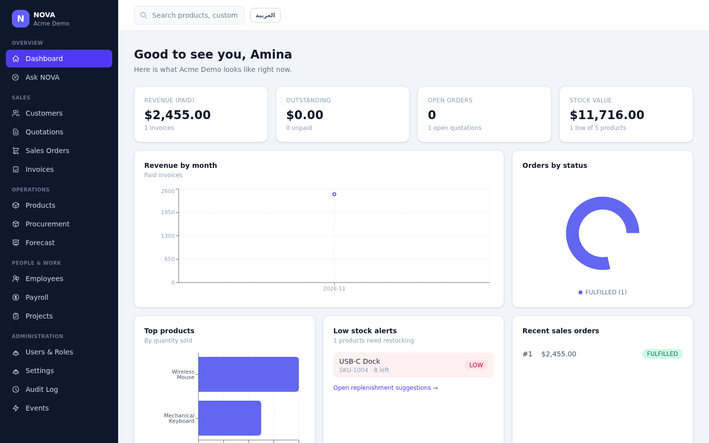
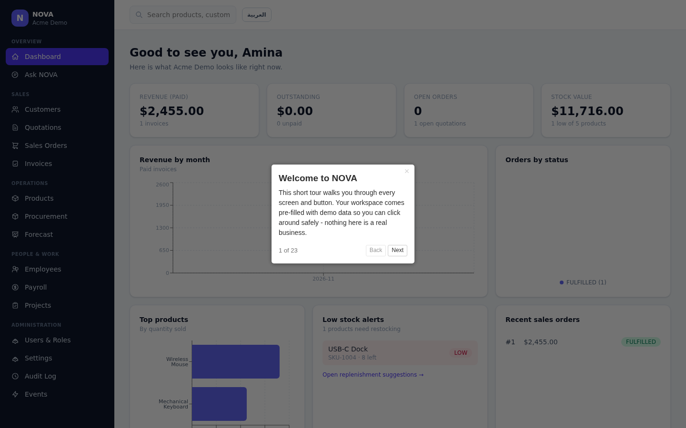
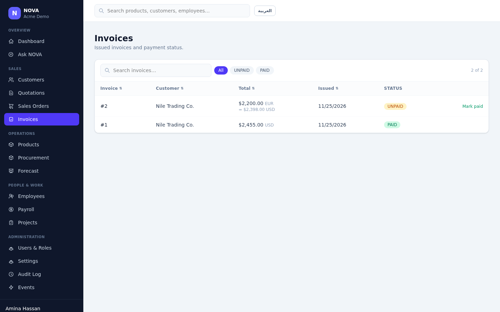
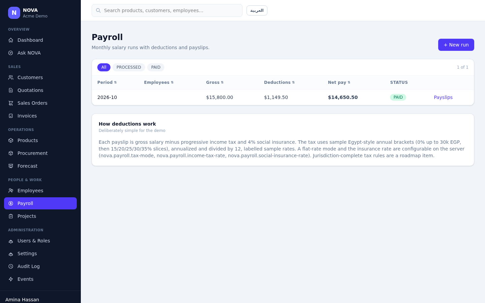
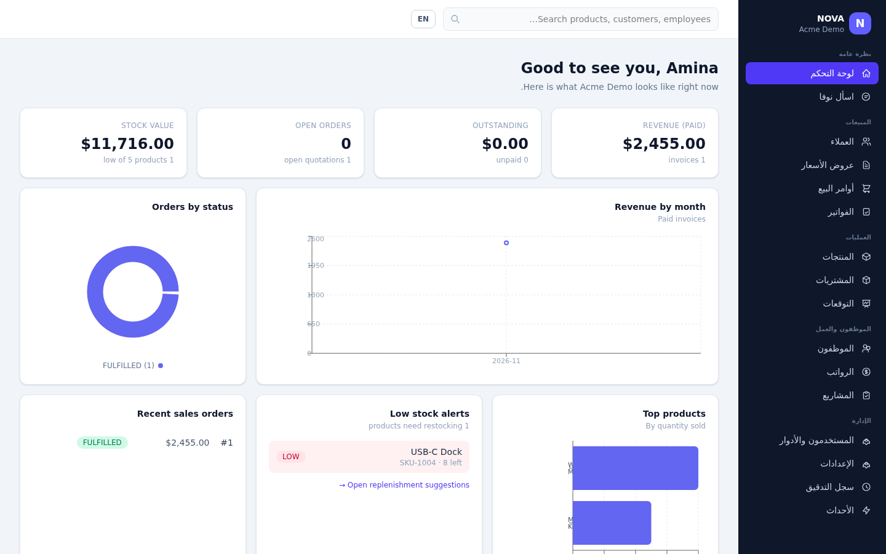
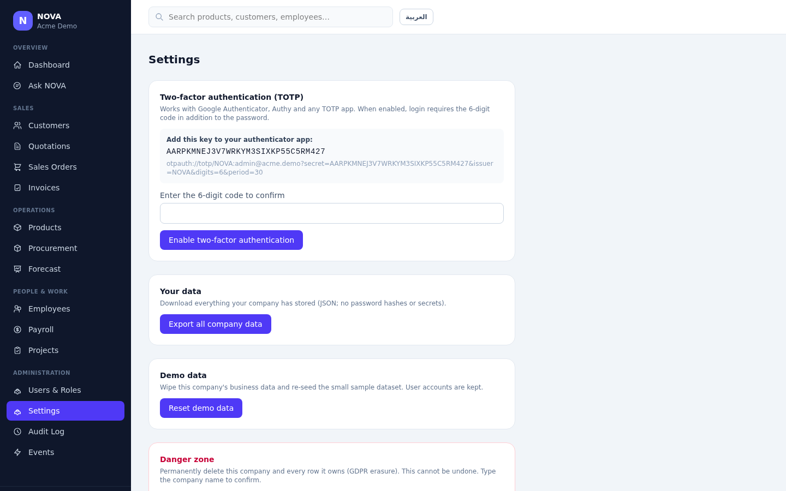

# NOVA - Business Operating System

NOVA is a finished, fully tested multi-tenant business management platform for small teams: sales, invoicing, inventory, procurement, HR, payroll, projects and demand forecasting in one clean web app - in English and Arabic, with full right-to-left support.

**Live demo:** https://nova-5se7.onrender.com (sign in with `admin@acme.demo` / `admin123`)
*The demo runs on free hosting that sleeps when idle - the first visit can take up to a minute to wake.*

## Feature tour

- **Sales flow, end to end** - customers, quotations, sales orders, multi-currency invoices, payment tracking.
- **Inventory & procurement** - live stock levels, low-stock alerts, CSV import, purchase orders that receive into stock.
- **HR & payroll** - employee directory, monthly payroll runs with configurable deduction brackets.
- **Projects** - tasks, deadlines and progress per customer or internal work.
- **Ask NOVA** - ask questions in plain words; answers are computed from your data by a rule-based engine.
- **Demand forecast** - a transparent statistical projection from your sales history. Every number is explainable; no machine-learning claims.
- **Guided onboarding tour** - a 23-step interactive walkthrough of every screen, in English and Arabic.
- **Multi-tenant & secure** - separate workspaces per company, role-based access, audit log, two-factor authentication.
- **English & Arabic** - one-click language toggle with complete RTL layout.

## Quality

- Automated backend and frontend test suites run green in CI on every commit (GitHub Actions: unit tests + Docker build).
- Ships as a single Docker image; deploys anywhere in minutes.
- The live demo is backed by a managed PostgreSQL database.

## Tech

Spring Boot (Java) - React + TypeScript - PostgreSQL - Docker. Source code is maintained in a private repository; contact the owner via GitHub for licensing or purchase inquiries: https://github.com/bassell01

## Screenshots

| Dashboard | Guided tour |
|---|---|
|  |  |

| Invoices (EUR) | Payroll |
|---|---|
|  |  |

| Arabic (RTL) | Two-factor setup |
|---|---|
|  |  |
